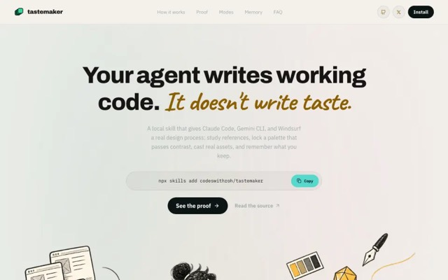
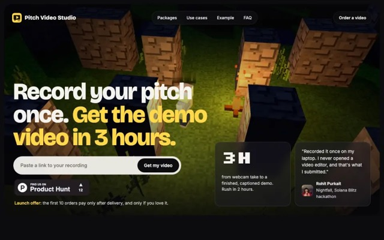
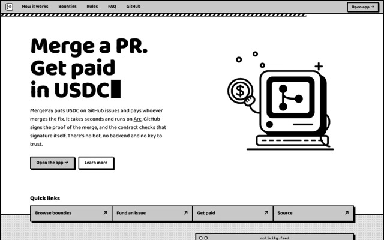
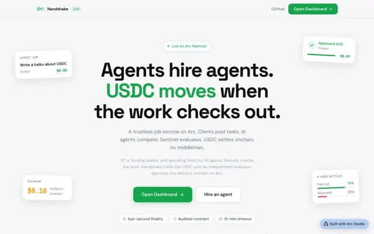
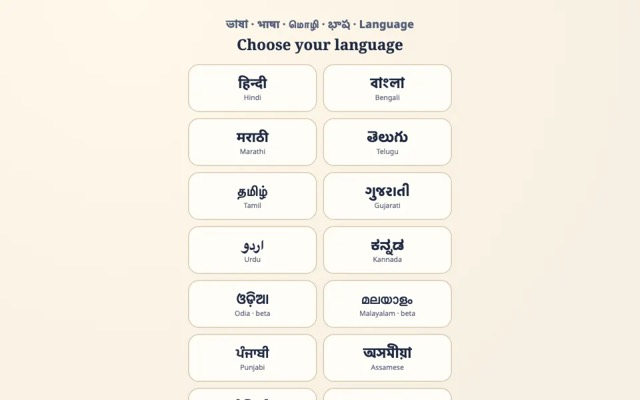
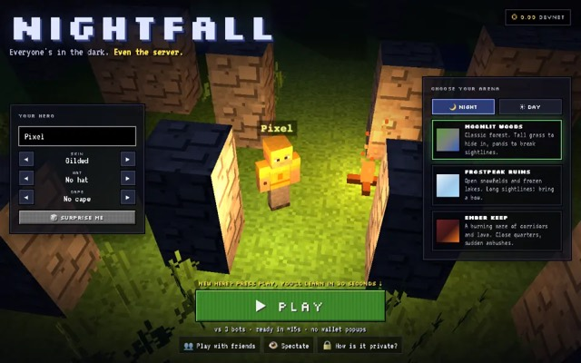

<a href="https://www.codeswithroh.online"><picture>
  <source media="(prefers-color-scheme: dark)" srcset="fight/readme-dark.svg">
  <source media="(prefers-color-scheme: light)" srcset="fight/readme-light.svg">
  </picture></a>

  <a href="https://www.codeswithroh.online"><b>codeswithroh.online</b></a> ·
  <a href="https://x.com/codeswithroh">X</a> ·
  <a href="https://linkedin.com/in/rohitpurkait">LinkedIn</a> ·
  <a href="https://youtube.com/@rohitpurkait4046">YouTube</a> ·
  <a href="mailto:rohitpurkait001@gmail.com">Email</a>

I build the product, then I get it seen. Growth engineer, AI engineer and social media strategist with 20+ hackathon wins. By day I'm a Developer Relations Engineer at BlokCapital.

| **20+** | **509** | **65** | **18** |
|:---:|:---:|:---:|:---:|
| hackathons won | stars on [Tastemaker](https://github.com/codeswithroh/tastemaker) | public repos in 2026 | chains shipped on |

## What I believe

**Software should check its own work.** Models are good enough to act now, so the useful question is who verifies them.

- In [Pakka](https://www.codeswithroh.online/projects/pakka) and [Baad Mein](https://www.codeswithroh.online/projects/baad-mein), the model reads and code verifies.
- In [MergePay](https://www.codeswithroh.online/projects/mergepay) and [Handshake](https://www.codeswithroh.online/projects/handshake), a contract checks the work before money moves.
- In [Bhoot](https://www.codeswithroh.online/projects/bhoot), git vouches for every claim.

The best AI for most people also runs on their own device, in their own language. [Chithi](https://www.codeswithroh.online/projects/chithi) exists because my mom reads Bengali, not English.

## Start here

<table>
<tr>
<td width="33%" valign="top"> <b>Tastemaker</b> Stops coding agents shipping the same UI. 509 stars</td>
<td width="33%" valign="top"> <b>Pitch Video</b> One talking-head take in, finished demo video out</td>
<td width="33%" valign="top"> <b>MergePay</b> USDC bounties paid on merge. Live on Arc mainnet</td>
</tr>
<tr>
<td width="33%" valign="top"> <b>Handshake</b> Agents hire agents. USDC moves when the work checks out</td>
<td width="33%" valign="top"> <b>Chithi</b> Reads bills aloud for my family, in 22 Indian languages</td>
<td width="33%" valign="top"> <b>Nightfall</b> Battle royale where even the server can't see you</td>
</tr>
</table>

## Everything, by what it does

<b>Agent tools</b> (7)

| Project | What it does | Links |
|---|---|---|
| [Tastemaker](https://www.codeswithroh.online/projects/tastemaker) | A skill that stops coding agents shipping the same indigo gradient. | [live](https://tastemaker-skill.online) · [code](https://github.com/codeswithroh/tastemaker) |
| [Pitch Video](https://www.codeswithroh.online/projects/pitch-video) | Record yourself reading the pitch. Your agent does the edit. | [live](https://pitch-video-studio.vercel.app) · [code](https://github.com/codeswithroh/pitch-video) |
| [TaskTape Replay](https://www.codeswithroh.online/projects/tasktape) | Show your work once. Replay it safely. | [live](https://tasktape-replay.vercel.app) · [code](https://github.com/codeswithroh/tasktape) |
| [TraceGate](https://www.codeswithroh.online/projects/tracegate) | If you could not debug the agent in production, it does not ship. | [live](https://tracegate.vercel.app) · [code](https://github.com/CodeswithrohStudio/TraceGate) |
| [InitCode](https://www.codeswithroh.online/projects/initcode) | Write and deploy CosmWasm contracts from a browser tab. | [live](https://initcode-eta.vercel.app) · [code](https://github.com/CodeswithrohStudio/initcode) |
| [Ideagram](https://www.codeswithroh.online/projects/ideagram) | One concept in, one recolored illustration out. | [code](https://github.com/codeswithroh/ideagram) |
| [SlashFill](https://www.codeswithroh.online/projects/slashfill) | Type /email anywhere and your address appears. | [code](https://github.com/codeswithroh/SlashFill) |

<b>On-device AI</b> (5)

| Project | What it does | Links |
|---|---|---|
| [Chithi](https://www.codeswithroh.online/projects/chithi) | A pocket reader for people who read Bengali but not English. | [live](https://chithi-teal.vercel.app) · [code](https://github.com/codeswithroh/chithi) |
| [Baad Mein](https://www.codeswithroh.online/projects/baad-mein) | One morning card from the chat you keep with yourself. | [live](https://baad-mein.vercel.app) · [code](https://github.com/codeswithroh/baad-mein) |
| [Pakka](https://www.codeswithroh.online/projects/pakka) | A home baker’s WhatsApp orders, turned into tomorrow’s bake sheet. | [live](https://pakka-gamma.vercel.app) · [code](https://github.com/codeswithroh/pakka) |
| [Drift](https://www.codeswithroh.online/projects/drift) | A walking app that wants your phone in your pocket. | [live](https://drift-three-nu.vercel.app) · [code](https://github.com/codeswithroh/drift) |
| [Bhoot](https://www.codeswithroh.online/projects/bhoot) | The people who left your repo, and the code of theirs that still runs. | [live](https://bhoot-graveyard.vercel.app) · [code](https://github.com/codeswithroh/bhoot) |

<b>AI products</b> (5)

| Project | What it does | Links |
|---|---|---|
| [cofoundr](https://www.codeswithroh.online/projects/cofoundr) | Find a co-founder in 60 seconds. | [live](https://cofoundrs.fun) |
| [Overturn](https://www.codeswithroh.online/projects/overturn) | Your insurer said no. Write back. | [live](https://overturn-eight.vercel.app) · [code](https://github.com/codeswithroh/overturn) |
| [FoundrProof](https://www.codeswithroh.online/projects/foundrproof) | Paste an X handle. Get a founder score and a roast. | [live](https://foundrproof.vercel.app) · [code](https://github.com/codeswithroh/foundrproof) |
| [Briefd](https://www.codeswithroh.online/projects/briefd) | Upload a client call. Get the scope doc. |  |
| [StreamReach](https://www.codeswithroh.online/projects/streamreach) | Citizen stream checks that reach a GP inside the EHR. | [live](https://oneaquahealth.vercel.app) · [code](https://github.com/codeswithroh/streamreach) |

<b>Agent payments</b> (6)

| Project | What it does | Links |
|---|---|---|
| [MergePay](https://www.codeswithroh.online/projects/mergepay) | Every merged pull request gets paid, with no middleman. | [live](https://mergepay.fun) · [code](https://github.com/codeswithroh/mergepay) |
| [Handshake](https://www.codeswithroh.online/projects/handshake) | Agents hire agents. USDC moves only when the work checks out. | [live](https://handshake-agents.vercel.app) · [code](https://github.com/codeswithroh/handshake) |
| [Longtail](https://www.codeswithroh.online/projects/longtail) | Liquidity for the prediction markets nobody quotes. | [live](https://longtail-rosy.vercel.app) · [code](https://github.com/codeswithroh/longtail) |
| [PayMesh](https://www.codeswithroh.online/projects/paymesh) | One line of middleware monetizes any API. | [code](https://github.com/CodeswithrohStudio/paymesh) |
| [CAPP](https://www.codeswithroh.online/projects/capp) | Scoped, revocable on-chain authority for AI agents. | [live](https://capp-protocol.vercel.app) · [code](https://github.com/codeswithroh/capp) |
| [Klyro](https://www.codeswithroh.online/projects/klyro) | Out-predict the machine. Settled on-chain. | [live](https://playklyro.fun) · [code](https://github.com/codeswithroh/klyro) |

<b>DeFi and markets</b> (9)

| Project | What it does | Links |
|---|---|---|
| [Hourglass](https://www.codeswithroh.online/projects/hourglass) | Buy an hour of GPU time as a token. | [live](https://hourglass-compute.vercel.app) · [code](https://github.com/codeswithroh/hourglass) |
| [Reckon](https://www.codeswithroh.online/projects/reckon) | Stops the transaction before your wallet opens. | [code](https://github.com/codeswithroh/reckon) |
| [Tape](https://www.codeswithroh.online/projects/tape-verified) | Copy trading where every return is proven on-chain. | [live](https://tape-verified.vercel.app) · [code](https://github.com/codeswithroh/tape-verified) |
| [Sextant](https://www.codeswithroh.online/projects/sextant) | Finds a stock’s true price when the real market is closed. | [live](https://sextant-sigma.vercel.app) · [code](https://github.com/codeswithroh/sextant) |
| [Yoldr](https://www.codeswithroh.online/projects/yoldr) | You only lose the yield. | [live](https://yoldr.vercel.app) · [code](https://github.com/CodeswithrohStudio/yoldr) |
| [LumenShield](https://www.codeswithroh.online/projects/lumenshield) | Principal-protected FXRP and FAsset vaults. | [live](https://lumenshield.vercel.app) · [code](https://github.com/CodeswithrohStudio/lumenshield) |
| [CrossShield](https://www.codeswithroh.online/projects/crossshield) | Gold, BTC and real estate exposure with principal locked. | [code](https://github.com/CodeswithrohStudio/crossshield) |
| [ENSPay](https://www.codeswithroh.online/projects/enspay) | Pay a .eth name. The receiver’s settings do the rest. | [code](https://github.com/CodeswithrohStudio/enspay) |
| [Will.eth](https://www.codeswithroh.online/projects/will-eth) | Beneficiaries watch the payout land in real time. | [live](https://willeth-somnia-reactive.vercel.app) · [code](https://github.com/CodeswithrohStudio/somnia-reactivity) |

<b>Privacy and proofs</b> (6)

| Project | What it does | Links |
|---|---|---|
| [Hall Monitor](https://www.codeswithroh.online/projects/hall-monitor) | Catches trackers on kids’ sites and seals the record on-chain. | [live](https://hall-monitor.codeswithroh.workers.dev) · [code](https://github.com/codeswithroh/hall-monitor) |
| [Nightfall](https://www.codeswithroh.online/projects/nightfall) | Fog of war where even the server cannot see you. | [live](https://nightfall-blitz.vercel.app) · [code](https://github.com/codeswithroh/nightfall) |
| [Veyl](https://www.codeswithroh.online/projects/veyl) | Trade without your wallet becoming a target. | [live](https://veyl-tau.vercel.app) · [code](https://github.com/codeswithroh/veyl) |
| [ShieldLink](https://www.codeswithroh.online/projects/shieldlink) | Pay a team without publishing the payroll. | [live](https://shieldlink-kappa.vercel.app) · [code](https://github.com/codeswithroh/shieldlink) |
| [ClaimProof](https://www.codeswithroh.online/projects/claim-proof) | Collect the payout without revealing the oracle reading. | [code](https://github.com/codeswithroh/claim-proof) |
| [FHE Liar’s Dice](https://www.codeswithroh.online/projects/fhe-liars-dice) | Not even the contract can see the dice. | [code](https://github.com/codeswithroh/fhe-liars-dice) |

## Growth

- [Tastemaker](https://github.com/codeswithroh/tastemaker): 0 to 509 stars in under four months
- [cofoundr](https://www.codeswithroh.online/projects/cofoundr): 500+ organic users with zero paid acquisition
- [Six videos](https://www.codeswithroh.online/proof-of-work) scripted, filmed, edited and posted solo

## Recognition

20+ hackathons won, including:

- **EthGlobal 2025:** winner
- **PL_Genesis (Protocol Labs):** winner with [Yoldr](https://www.codeswithroh.online/projects/yoldr)
- **SEBI National Hackathon:** Jury Recommendation Award, led a team of 20
- **Postman:** Student Leader and Expert

## Stack

Growth engineering · Social strategy · Short video · SEO · TypeScript · Python · Solidity · Cadence · Rust · Next.js · NestJS · FastAPI · Claude · MCP · Gemma · viem · Foundry

Need someone who builds it and sells it? [Say hi](mailto:rohitpurkait001@gmail.com).
